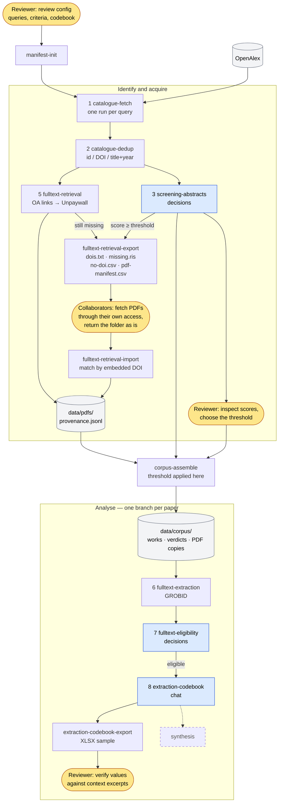

# Pipeline

The pipeline has two halves that meet at one on-disk artifact, the
[corpus](corpus.md). The first half finds the literature and acquires
the PDFs; the second half analyses the papers in the corpus and reads
nothing else. Acquisition runs on several machines operated by
collaborators with different institutional access; the corpus is its
durable product, and the analysis built on it may change while the
corpus stays the base.

This is a literature overview in the natural sciences. Conventions from
stricter traditions (adjudication, consensus runs, dual screening,
reviewer workbooks per gate) stay out unless they earn their keep here.
Refining the search, the criteria, the codebook or the vocabulary is
ordinary editing of the configs followed by a re-run.

Stages keep their original numbers. Numbers 4 and 9 are unused.

## Stages

| # | Stage | Half |
|---|---|---|
| 1 | [catalogue-fetch](#1-catalogue-fetch) | identify and acquire |
| 2 | [catalogue-dedup](#2-catalogue-dedup) | identify and acquire |
| 3 | [screening-abstracts](#3-screening-abstracts) | identify and acquire |
| 5 | [fulltext-retrieval](#5-fulltext-retrieval) | identify and acquire |
| — | [corpus-assemble](#corpus-assemble) | the meeting point |
| 6 | [fulltext-extraction](#6-fulltext-extraction) | analyse |
| 7 | [fulltext-eligibility](#7-fulltext-eligibility) | analyse |
| 8 | [extraction-codebook](#8-extraction-codebook) | analyse |
| — | [synthesis](#synthesis) (planned) | analyse |

## First half: identify and acquire

Stages 1–3 operate on the **catalogue**: metadata and abstracts, no
full text. Stage 5 fills the PDF store. Screening and retrieval are
independent of each other: either can run first, or both in parallel.

### 1. catalogue-fetch

Queries OpenAlex with the search strategy and stores validated
bibliographic records. The output is intentionally broad: it captures
the relevant search space before any screening. Several queries may be
needed to cover different sub-disciplines. See
[catalogue-fetch.md](catalogue-fetch.md).

- **Consumes:** OpenAlex API, search strategy
- **Produces:** retrieved catalogue, one file per query

### 2. catalogue-dedup

Removes duplicate records that arise when queries overlap or when the
same work appears under different OpenAlex IDs. Matches on OpenAlex ID,
DOI, and title + author + year. See [catalogue-dedup.md](catalogue-dedup.md).

- **Consumes:** retrieved catalogue
- **Produces:** deduplicated catalogue

### 3. screening-abstracts

Asks a decisions model, for each abstract, whether the work is relevant
to the review, and stores the probability as a 0–100 relevance score.
The stage flags rather than filters: it writes one `ScreeningVerdict`
per work and applies no threshold. See
[screening-abstracts.md](screening-abstracts.md).

- **Consumes:** deduplicated catalogue, screening criteria
- **Produces:** per-work `ScreeningVerdict` sidecar (`verdicts.jsonl`)

### 5. fulltext-retrieval

Fills the persistent, work-keyed PDF store `data/pdfs/` from open-access
sources for every work in the deduplicated catalogue; screening never
gates it. The still-missing works go to collaborators through an
export/import loop: `fulltext-retrieval-export` writes a handoff bundle
of the still-missing works that pass a screening-score threshold, since
collaborator time is the cost worth saving, and `fulltext-retrieval-import` brings the returned
PDFs back into the store. Only the operator writes the store. See
[fulltext-retrieval.md](fulltext-retrieval.md) and
[pdf-store.md](pdf-store.md).

- **Consumes:** deduplicated catalogue; for the export, also the
  screening verdicts
- **Produces:** PDFs in `data/pdfs/`, one provenance record per work

## corpus-assemble

Selects the works for analysis and copies their PDFs into the
self-contained `data/corpus/`. It is the only place the screening
threshold is applied. Works without a score are included, because
stage 7 still judges them on the full text, and works without a PDF are
included too. The corpus records a content-based `corpus_id` that every
analysis output carries. See [corpus.md](corpus.md).

- **Consumes:** deduplicated catalogue, screening verdicts, screening
  threshold, PDF store
- **Produces:** `data/corpus/`

## Second half: analyse

### One branch per paper

Once the corpus is assembled, each paper moves through analysis
independently. No analysis stage looks across papers, and no per-paper
record is rewritten from cross-paper results. Synthesis, at the end, is
the only aggregation. Cross-paper work (deduplication, import matching,
vocabulary term frequencies) happens before the corpus.

### 6. fulltext-extraction

Parses the corpus PDFs into structured sections with GROBID and keeps
the TEI XML as the canonical artifact. GROBID belongs to this half
because the PDF is the scarce artifact and its text can always be
re-extracted, so acquisition machines need no Docker. See
[fulltext-extraction.md](fulltext-extraction.md).

- **Consumes:** corpus PDFs
- **Produces:** TEI per work and an `ExtractedDocument` index

### 7. fulltext-eligibility

A cheap full-text pass in front of codebook extraction. A decisions
model answers one yes/no question per paper on the rendered full text:
does it track particles, tracers or objects in an ocean flow field, and
is it primary research? Papers without a methods description stay in;
they count as non-reproducible for RQ1.1. The stage is full-text-only:
works without a current extraction are skipped, not flagged. See
[eligibility.md](eligibility.md).

- **Consumes:** corpus works, extractions, eligibility criteria
- **Produces:** per-work `EligibilityVerdict` sidecar

### 8. extraction-codebook

An LLM fills the codebook for each eligible paper: sub-discipline tags,
numerical integration scheme, time-step strategy, interpolation method,
reproducibility indicators, the stated rationale for numerical choices,
and a verbatim context snippet for each value. Like stage 7 it is
full-text-only. It refuses eligibility verdicts made on another corpus
or with other criteria. See [extraction-codebook.md](extraction-codebook.md)
and [codebook.md](codebook.md).

- **Consumes:** corpus works, eligibility verdicts, extractions,
  codebook
- **Produces:** one `ExtractionRecord` per processed paper

### Synthesis

Planned, not built. One step aggregates the extraction records into
answers to the research questions: quantitative summaries for RQ1.1
(reproducibility) and RQ1.2 (prevalence), and a grouping of the stated
rationales for RQ1.3. Whether the rationale grouping keeps human
labelling is decided when synthesis is designed.

- **Consumes:** extraction records
- **Produces:** to be designed

## Human spot-checking

`extraction-codebook-export` writes an XLSX workbook for spot-checking
stage 8: a random subset (`--n-subset` / `--subset-seed`), one tab per
work with each codebook field's value and context, and an Index sheet
for navigation. It is read-only; nothing flows back into the data.
Screening and eligibility verdicts are inspected directly on their
`verdicts.jsonl`. The screening threshold is chosen by looking at the
screening scores before `corpus-assemble`.

## Shared resources

### Vocabulary

A concept-tagged term list ([vocabulary.md](vocabulary.md)) for
deterministic keyword matching against text, usable alongside LLM
screening, for locating methods sections in
[two-pass extraction](two-pass-extraction.md), and for refining the
search strategy. Not a pipeline stage and not yet implemented.

## Pipeline flowchart

Rounded yellow nodes are human steps, blue nodes call the review's LLM
endpoint, grey cylinders are data on disk. Dashed nodes are planned but
not built. Only the collaborator PDF loop writes back into the data;
the XLSX workbook is a read-only surface.

